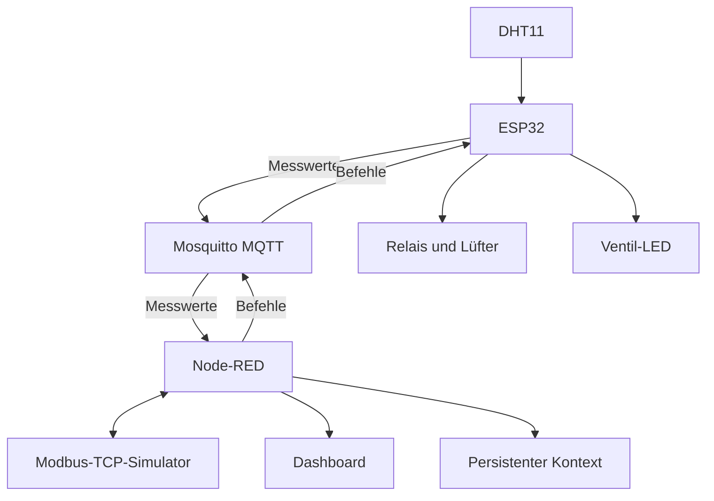
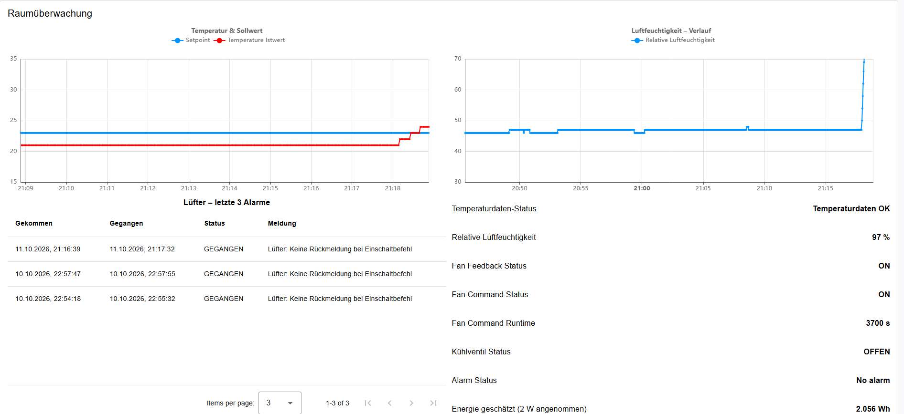
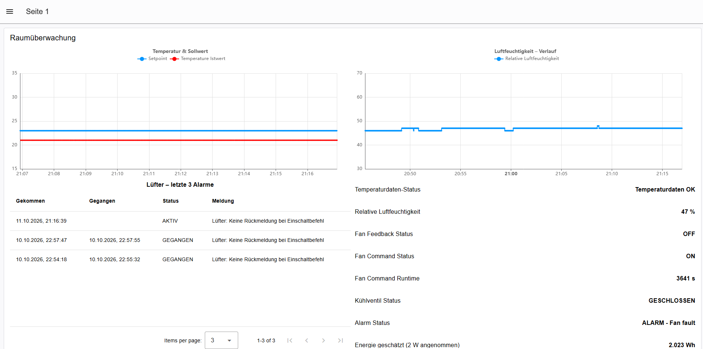
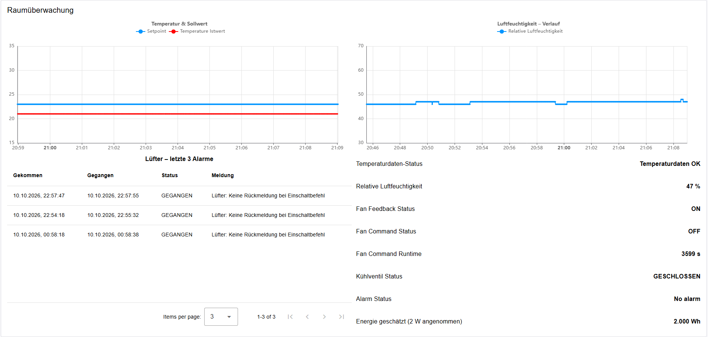
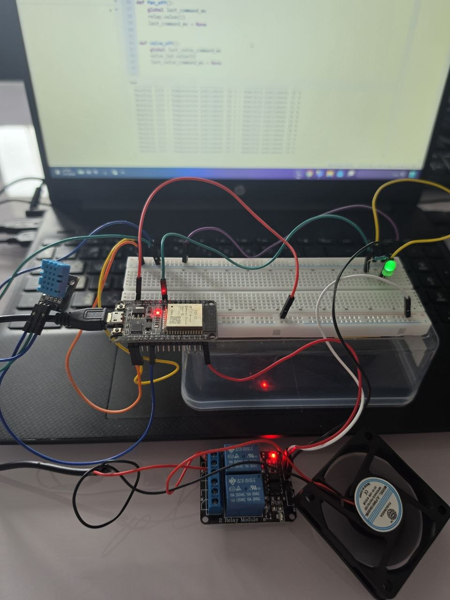
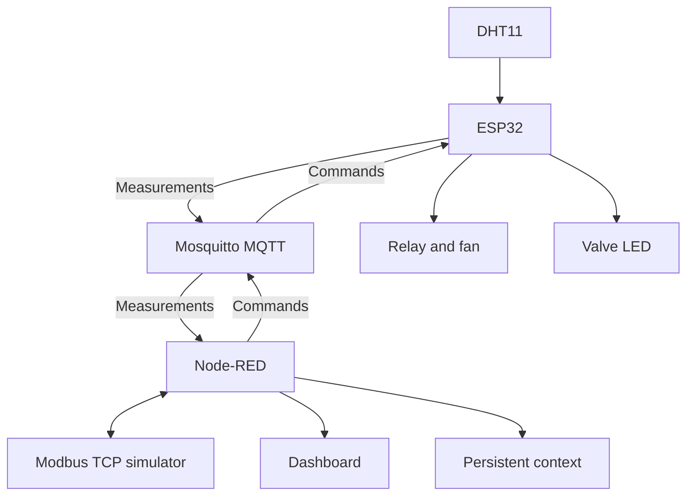

# BMS mit ESP32, MQTT und Modbus TCP

🇩🇪 Deutsch | 🇬🇧 English below

## Projektübersicht

Praktisches Gebäudeautomationsprojekt für einen Raum: Ein ESP32 erfasst Temperatur und Luftfeuchtigkeit mit einem DHT11. Node-RED auf einem Raspberry Pi verarbeitet die Messwerte und steuert einen realen 5-V-Lüfter über MQTT.

Das Projekt verbindet Sensorik, Steuerungslogik, ein Dashboard, einen Modbus-TCP-Simulator, Alarmhistorie und persistente Datenhaltung.

Dieses persönliche Lern- und Portfolio-Projekt baut auf [Mini-BMS-HVAC-Automation](https://github.com/ahmad-energy-iot/Mini-BMS-HVAC-Automation) auf. Die Erweiterungen umfassen die ESP32-Anbindung, reale Messwerte und Lüftersteuerung, Luftfeuchtigkeit, eine Ventil-LED, Wiederverbindung, persistente Alarmhistorie sowie eine Energieabschätzung.

## Funktionen

- Temperatur- und Luftfeuchtemessung ungefähr alle 2 Sekunden.
- Übertragung der Messwerte über MQTT.
- AUTO- und MANUAL-Betrieb.
- Temperaturregelung mit Hysterese: Bei einem Sollwert von 23 °C erfolgt das Einschalten ab 24 °C und das Ausschalten bei höchstens 22 °C.
- MQTT-Ansteuerung eines Relais für den realen Lüfter.
- Getrennte MQTT-Befehle für eine LED, die ein Kühlventil darstellt.
- Modbus-TCP-Simulator für Sollwert, Lüfterbefehl und simulierte Rückmeldung.
- Überwachung der Temperaturdaten mit einer Wartezeit von 5 Sekunden.
- Alarm bei Einschaltbefehl ohne simulierte Lüfterrückmeldung.
- Speicherung der letzten drei Alarmereignisse mit Beginn, Ende und Status.
- Persistenter Zähler für die Dauer des Lüfter-ON-Befehls.
- Energieabschätzung mit einer angenommenen Leistung von 2 W.
- Dashboard mit Messwerten, Trends, Zuständen, Alarmhistorie und Energieabschätzung.
- Wiederverbindung des ESP32 nach WiFi- oder MQTT-Unterbrechungen.

## Hardware und Software

| Bestandteil | Aufgabe |
|---|---|
| Raspberry Pi | Plattform für Node-RED und MQTT-Broker |
| ESP32 | Sensorabfrage und Ansteuerung der Ausgänge |
| DHT11 | Messung von Temperatur und Luftfeuchtigkeit |
| Relaismodul | Schalten des Lüfters |
| 5-V-Lüfter | Realer Aktor im Versuchsaufbau |
| LED mit Vorwiderstand | Darstellung eines Kühlventils |
| Node-RED | Verarbeitung, Regelung, Überwachung und Dashboard |
| Mosquitto | MQTT-Broker |
| MicroPython | Firmware auf dem ESP32 |
| Modbus-TCP-Simulator | Simulierte Automationsstation innerhalb von Node-RED |

## Real, simuliert und geschätzt

| Bestandteil | Umsetzung |
|---|---|
| Temperatur und Luftfeuchtigkeit | Reale DHT11-Messwerte |
| Lüfter | Realer 5-V-Lüfter, über ein Relais geschaltet |
| Lüfterrückmeldung | Per Inject und Modbus simuliert; keine Drehzahlmessung |
| Kühlventil | Steuerungslogik mit LED; kein physisches Ventil |
| Automationsstation | Modbus-TCP-Simulator in Node-RED |
| Laufzeit | Dauer des ON-Befehls; keine bestätigte mechanische Betriebszeit |
| Energie | Befehlsdauer × angenommene 2 W; keine elektrische Messung |

## Architektur



## ESP32-Anschlüsse

| Signal | GPIO | Verhalten |
|---|---|---|
| DHT11-Datenleitung | GPIO4 | Temperatur- und Luftfeuchtemessung |
| Lüfterrelais IN2 | GPIO23 | Active LOW: LOW = EIN, HIGH = AUS |
| Ventil-LED | GPIO26 | HIGH = EIN, LOW = AUS |

Die Ventil-LED wird über einen Vorwiderstand angeschlossen. Die Kathode wird mit GND verbunden.

Die Ausgänge starten im ausgeschalteten Zustand: Das Lüfterrelais steht auf HIGH und die Ventil-LED auf LOW.

## MQTT-Datenpunkte

| Topic | Richtung | Inhalt |
|---|---|---|
| `bms/room1/temperature` | ESP32 → Node-RED | Temperatur in °C |
| `bms/room1/humidity` | ESP32 → Node-RED | Relative Luftfeuchtigkeit in % |
| `bms/room1/fan/command` | Node-RED → ESP32 | `ON` oder `OFF` |
| `bms/room1/valve/command` | Node-RED → ESP32 | `ON` oder `OFF` |

Die Firmware verwendet MQTT-Port 1883. Temperatur und Luftfeuchtigkeit werden ohne Retain veröffentlicht.

WiFi- und MQTT-Zugangsdaten müssen lokal ergänzt werden. Passwörter werden nicht im Repository veröffentlicht.

## Steuerungslogik

### AUTO-Betrieb

Node-RED verarbeitet die Temperatur und erzeugt den Lüfterbefehl anhand einer Hysterese.

Beim Sollwert von 23 °C gilt:

- Temperatur ab 24 °C: Lüfter einschalten.
- Temperatur bis einschließlich 22 °C: Lüfter ausschalten.
- Zwischen 22 °C und 24 °C: bisherigen Zustand beibehalten.

Die Hysterese verhindert häufiges Umschalten nahe am Sollwert.

### MANUAL-Betrieb

Im manuellen Betrieb wird der Lüfterbefehl über Inject-Nodes im Node-RED-Editor vorgegeben.

Die manuelle Bedienung erfolgt im aktuellen Flow nicht über Dashboard-Schaltflächen.

### Ventilsimulation

Eine LED am ESP32 stellt den Zustand eines Kühlventils dar. Sie erhält separate MQTT-Befehle.

Damit wird die Ansteuerung eines zweiten Ausgangs demonstriert. Ein physisches Ventil und dessen mechanische Rückmeldung sind nicht Bestandteil des Aufbaus.

## Modbus TCP und Rückmeldung

Ein Modbus-TCP-Simulator innerhalb von Node-RED stellt Datenpunkte für Sollwert, Lüfterbefehl und simulierte Lüfterrückmeldung bereit.

Die Rückmeldung wird zu Testzwecken simuliert. Sie stammt nicht von einem Drehzahlsensor oder einem Rückmeldekontakt am realen Lüfter.

Der Aufbau zeigt den Unterschied zwischen:

- **Befehl:** Der Lüfter soll eingeschaltet sein.
- **Rückmeldung:** Die simulierte Rückmeldung meldet den Lüfter als eingeschaltet.

Die konkreten Modbus-Einstellungen und Adressen sind im exportierten Flow enthalten.

## Überwachung und Alarmhistorie

### Temperaturdatenüberwachung

Der Flow überwacht das Ausbleiben von Temperaturdaten mit einer Wartezeit von 5 Sekunden.

### Lüfterrückmeldungsalarm

Ein Alarm wird ausgewertet, wenn ein Einschaltbefehl anliegt und die simulierte Rückmeldung fehlt.

Die Auswertung erfolgt nach mindestens 5 Sekunden bei der nächsten eingehenden Nachricht. Die Verzögerung ist deshalb kein unabhängig laufender, exakt nach 5 Sekunden auslösender Timer.

### Alarmhistorie

Die letzten drei Alarmereignisse werden mit Beginn, Ende und Status gespeichert und im Dashboard angezeigt.

Die persistente Speicherung erfolgt über einen benannten Node-RED-Kontextspeicher `file`. Dieser muss separat in `settings.js` eingerichtet werden.

## Befehlsdauer und Energieabschätzung

Der Zähler erfasst die Dauer, während der der Lüfterbefehl auf `ON` steht.

Diese Zeit ist keine Messung der tatsächlichen mechanischen Lüfterlaufzeit. Auch bei fehlender realer Rückmeldung kann ein ON-Befehl anliegen.

Die Energie wird aus der Befehlsdauer und einer angenommenen Leistung von **2 W** berechnet:

```text
Geschätzte Energie [Wh] = ON-Befehlsdauer [s] ÷ 3600 × 2 W
```

Beispiel:

```text
2990 s ÷ 3600 × 2 W ≈ 1,661 Wh
```

Die Energieanzeige kann dabei **1,662 Wh** anzeigen, weil die Berechnung die vollständige Zeit in Millisekunden verwendet, während der Sekundenzähler nur ganze Sekunden anzeigt.

Bei `OFF` bleiben Zähler und Energie nach Verarbeitung des letzten ON-Intervalls konstant.

Die Anzeige ist eine rechnerische Abschätzung. Spannung, Strom und reale elektrische Energie werden nicht gemessen.

## ESP32-Verbindungs- und Ausgangsverhalten

Die MicroPython-Firmware umfasst:

- WiFi-Verbindungsaufbau mit einer Wartezeit von maximal 20 Sekunden pro Versuch.
- MQTT-Verbindung und Abonnement der beiden Befehlstopics.
- Wiederholungsversuche nach Verbindungsfehlern.
- Ausschalten beider Ausgänge bei einem erkannten Verbindungsfehler.
- Ausschalten des betreffenden Ausgangs bei einem ungültigen Befehl.
- Befehlsüberwachung mit einer eingestellten Zeit von 10 Sekunden.
- Ausschalten beider Ausgänge beim regulären Beenden des Programms.

Für einen dauerhaft eingeschalteten Ausgang müssen gültige Befehle rechtzeitig erneut eintreffen.

Die Zeitüberwachung wird in der Programmschleife geprüft. Blockierende Netzwerkoperationen können die Reaktion verzögern; der Aufbau ist keine zertifizierte Sicherheitssteuerung.

## Dashboard

Das Dashboard stellt die wichtigsten Messwerte und Betriebsinformationen dar:

- Temperatur und Luftfeuchtigkeit.
- Zwei Trenddiagramme im aktuellen Export.
- Lüfterbefehl und simulierte Rückmeldung.
- Alarmstatus und letzte drei Alarmereignisse.
- Gespeicherte ON-Befehlsdauer.
- Geschätzte Energie.

Der exportierte Flow enthält den Tab **BMS Step2** mit seinen Konfigurationsknoten. Frühere Dashboard-Elemente aus **Flow 1** sind nicht Bestandteil dieses Exports.

## Dateien

| Datei | Inhalt |
|---|---|
| [flows/bms-step2-flow.json](flows/bms-step2-flow.json) | Exportierter Node-RED-Flow |
| [firmware/esp32_bms_step2.py](firmware/esp32_bms_step2.py) | MicroPython-Firmware ohne Passwörter |
| [docs/PROJECT_DOCUMENTATION.md](docs/PROJECT_DOCUMENTATION.md) | Ausführliche Projektdokumentation |
| [config/context-storage.example.js](config/context-storage.example.js) | Beispiel für den persistenten Node-RED-Kontext |

## Inbetriebnahme

1. Node-RED und Mosquitto auf dem Raspberry Pi bereitstellen.
2. Die im Flow verwendeten Dashboard- und Modbus-Pakete installieren.
3. Den benannten Kontextspeicher `file` in Node-RED `settings.js` konfigurieren.
4. Node-RED neu starten.
5. `flows/bms-step2-flow.json` importieren.
6. MQTT-Broker-Adresse und Zugangsdaten lokal im Broker-Konfigurationsknoten prüfen und ergänzen.
7. Modbus-Verbindungsparameter für die lokale Umgebung prüfen.
8. WiFi- und MQTT-Einstellungen in der ESP32-Firmware lokal ergänzen.
9. Die Firmware als `main.py` auf den ESP32 übertragen.
10. Den Flow deployen, das Dashboard öffnen und die Tests durchführen.

Die Firmware-Vorlage mit leeren Zugangsdaten ist nicht direkt betriebsbereit.

Broker-Zugangsdaten sowie gespeicherte Zähler- und Alarmwerte sind nicht im Flow-Export enthalten. Die Konfiguration des Kontextspeichers wird ebenfalls separat eingerichtet.

## Praktisch erprobte Szenarien

Am persönlichen Versuchsaufbau wurden folgende Szenarien geprüft:

- Temperaturregelung mit Hysterese 24/22 °C.
- Reale Lüfteransteuerung über MQTT und Relais.
- Simulierte fehlende Lüfterrückmeldung.
- Alarmbeginn und Alarmende.
- Begrenzung der Alarmhistorie auf drei Ereignisse.
- Wiederverbindung nach Kommunikationsunterbrechungen.
- Erhalt von Befehlsdauer und Alarmhistorie nach Node-RED-Neustart.
- Rechnerischer Vergleich der Energieanzeige mit der ON-Befehlsdauer.

Diese Angaben beschreiben Tests am persönlichen Laboraufbau. Sie ersetzen keine Abnahme einer produktiven Gebäudeanlage.

## Was ich gelernt habe

- Sensoren und Aktoren über einen ESP32 anbinden.
- MQTT-Kommunikation zwischen ESP32 und Node-RED aufbauen.
- Datenpunkte über Modbus TCP integrieren.
- Betriebsarten, Zustände und Hysterese modellieren.
- Befehle von Rückmeldungen unterscheiden.
- Kommunikationsfehler und Wiederverbindung untersuchen.
- Alarmereignisse und Zähler persistent speichern.
- Reale Messungen, Simulationen und Schätzungen klar dokumentieren.

## Grenzen und mögliche Erweiterungen

Dies ist ein persönlicher Labor- und Lernaufbau für einen Raum.

Mögliche Erweiterungen:

- Multi-Zone-Regelung.
- BACnet/IP-Anbindung.
- Reale Lüfterrückmeldung.
- Elektrischer Energiezähler.
- Erweiterte Alarmhistorie.
- Zusätzliche Dashboard-Gestaltung.

---
## Projektbilder und Video / Screenshots and Video

### Dashboard – Kühlbetrieb / Cooling operation

Lüfterbefehl und simulierte Rückmeldung ON; das durch eine LED dargestellte Kühlventil ist freigegeben.



### Dashboard – Alarmprüfung / Alarm test

Einschaltbefehl ohne simulierte Lüfterrückmeldung: Der Alarm erscheint auch in der Historie.



### Dashboard – Befehl OFF / Command OFF

Lüfterbefehl OFF und Ventil geschlossen. Die simulierte Rückmeldung ist in dieser Aufnahme weiterhin ON.



### Hardware

Realer ESP32-Aufbau mit DHT11, Relais, 5-V-Lüfter und LED zur Ventildarstellung.



[Hardware mit ausgeschalteter Ventil-LED ansehen](images/hardware-off.jpg)

### Node-RED und ESP32-Testausgaben / Flow and test logs

[Node-RED-Flow ansehen](images/node-red-flow.png)

[ESP32: ON-Befehle bei 24 °C](images/esp32-command-on.png)

[ESP32: OFF-Befehle bei 22 °C](images/esp32-command-off.png)

### Hardware-Video / Hardware demonstration

[▶ Hardware-Demonstration ansehen](videos/Add%20hardware%20demonstration%20video.mp4)

Die grüne LED stellt ein Kühlventil dar. Die Lüfterrückmeldung wird in Node-RED simuliert.

The green LED represents a cooling valve. Fan feedback is simulated in Node-RED.
.
.
.
.

English:


# BMS with ESP32, MQTT and Modbus TCP

## Project Overview

Practical building automation project for one room: An ESP32 measures temperature and relative humidity using a DHT11. Node-RED on a Raspberry Pi processes the measurements and controls a real 5 V fan over MQTT.

The project combines sensors, control logic, a dashboard, a Modbus TCP simulator, alarm history and persistent data storage.

This personal learning and portfolio project builds on [Mini-BMS-HVAC-Automation](https://github.com/ahmad-energy-iot/Mini-BMS-HVAC-Automation). The extensions include ESP32 integration, real measurements and fan control, humidity monitoring, a valve LED, reconnection, persistent alarm history and an energy estimate.

## Features

- Temperature and humidity measurements approximately every 2 seconds.
- Measurement transmission over MQTT.
- AUTO and MANUAL operation.
- Temperature control with hysteresis: At a 23 °C setpoint, the fan switches on at 24 °C or above and off at 22 °C or below.
- MQTT control of a relay connected to the real fan.
- Separate MQTT commands for an LED representing a cooling valve.
- Modbus TCP simulator for the setpoint, fan command and simulated feedback.
- Temperature data monitoring with a 5-second waiting period.
- Alarm for an ON command without simulated fan feedback.
- Storage of the latest three alarm events, including start, end and status.
- Persistent counter for the duration of the fan ON command.
- Energy estimate using an assumed power of 2 W.
- Dashboard with measurements, trends, states, alarm history and estimated energy.
- ESP32 reconnection after WiFi or MQTT interruptions.

## Hardware and Software

| Component | Purpose |
|---|---|
| Raspberry Pi | Platform for Node-RED and the MQTT broker |
| ESP32 | Sensor readings and output control |
| DHT11 | Temperature and humidity measurements |
| Relay module | Fan switching |
| 5 V fan | Real actuator in the laboratory setup |
| LED with series resistor | Cooling valve representation |
| Node-RED | Processing, control, monitoring and dashboard |
| Mosquitto | MQTT broker |
| MicroPython | ESP32 firmware |
| Modbus TCP simulator | Simulated automation controller inside Node-RED |

## Real, Simulated and Estimated

| Component | Implementation |
|---|---|
| Temperature and humidity | Real DHT11 measurements |
| Fan | Real 5 V fan switched by a relay |
| Fan feedback | Simulated through Inject and Modbus; no speed measurement |
| Cooling valve | Control logic with an LED; no physical valve |
| Automation controller | Modbus TCP simulator in Node-RED |
| Runtime | ON-command duration; not confirmed mechanical operating time |
| Energy | Command duration × assumed 2 W; no electrical measurement |

## Architecture



## ESP32 Connections

| Signal | GPIO | Behaviour |
|---|---|---|
| DHT11 data | GPIO4 | Temperature and humidity readings |
| Fan relay IN2 | GPIO23 | Active LOW: LOW = ON, HIGH = OFF |
| Valve LED | GPIO26 | HIGH = ON, LOW = OFF |

The valve LED uses a series resistor, with its cathode connected to GND.

Both outputs start switched off: The fan relay is HIGH and the valve LED is LOW.

## MQTT Data Points

| Topic | Direction | Payload |
|---|---|---|
| `bms/room1/temperature` | ESP32 → Node-RED | Temperature in °C |
| `bms/room1/humidity` | ESP32 → Node-RED | Relative humidity in % |
| `bms/room1/fan/command` | Node-RED → ESP32 | `ON` or `OFF` |
| `bms/room1/valve/command` | Node-RED → ESP32 | `ON` or `OFF` |

The firmware uses MQTT port 1883. Temperature and humidity are published without retain.

WiFi and MQTT credentials must be configured locally. Passwords are not published in the repository.

## Control Logic

### AUTO Mode

Node-RED processes the temperature and generates the fan command using hysteresis.

At a 23 °C setpoint:

- Temperature at or above 24 °C: Switch the fan on.
- Temperature at or below 22 °C: Switch the fan off.
- Between 22 °C and 24 °C: Keep the previous state.

Hysteresis prevents frequent switching near the setpoint.

### MANUAL Mode

In manual mode, the fan command is set through Inject nodes in the Node-RED editor.

The current flow does not provide manual operation through dashboard buttons.

### Valve Simulation

An ESP32 LED represents a cooling valve and receives separate MQTT commands.

This demonstrates control of a second output. A physical valve and its mechanical feedback are not part of the setup.

## Modbus TCP and Feedback

A Modbus TCP simulator inside Node-RED provides data points for the setpoint, fan command and simulated fan feedback.

The feedback is simulated for testing. It does not originate from a speed sensor or feedback contact on the real fan.

The setup demonstrates the distinction between:

- **Command:** The fan should be switched on.
- **Feedback:** The simulated feedback reports that the fan is on.

The specific Modbus settings and addresses are included in the exported flow.

## Monitoring and Alarm History

### Temperature Data Monitoring

The flow monitors missing temperature data using a 5-second waiting period.

### Fan Feedback Alarm

An alarm is evaluated when an ON command is present but simulated feedback is missing.

Evaluation occurs after at least 5 seconds, on the next incoming message. The delay is therefore not an independent timer that triggers exactly after 5 seconds.

### Alarm History

The latest three alarm events are stored with start, end and status and displayed on the dashboard.

Persistent storage uses a named Node-RED context store called `file`. This store must be configured separately in `settings.js`.

## Command Duration and Energy Estimate

The counter records the duration for which the fan command is `ON`.

This is not a measurement of the fan's actual mechanical operating time. An ON command may be present even without real feedback.

Energy is calculated from command duration and an assumed power of **2 W**:

```text
Estimated energy [Wh] = ON-command duration [s] ÷ 3600 × 2 W
```

Example:

```text
2990 s ÷ 3600 × 2 W ≈ 1.661 Wh
```

The energy display may show **1.662 Wh** because the calculation uses the full time in milliseconds, while the seconds counter displays whole seconds only.

When the command is `OFF`, the counter and energy remain constant after the final ON interval has been processed.

This is a calculated estimate. Voltage, current and actual electrical energy are not measured.

## ESP32 Connection and Output Behaviour

The MicroPython firmware includes:

- WiFi connection attempts with a maximum waiting period of 20 seconds per attempt.
- MQTT connection and subscription to both command topics.
- Retry attempts after connection errors.
- Switching both outputs off when a connection error is detected.
- Switching the relevant output off after an invalid command.
- Command monitoring with a configured timeout of 10 seconds.
- Switching both outputs off during normal program shutdown.

Valid commands must arrive again before the timeout to keep an output continuously on.

Timeout checks run in the main program loop. Blocking network operations can delay the response; this setup is not a certified safety controller.

## Dashboard

The dashboard presents the main measurements and operating information:

- Temperature and humidity.
- Two trend charts in the current export.
- Fan command and simulated feedback.
- Alarm status and the latest three alarm events.
- Stored ON-command duration.
- Estimated energy.

The exported flow contains the **BMS Step2** tab and its configuration nodes. Earlier dashboard elements from **Flow 1** are not included in this export.

## Files

| File | Content |
|---|---|
| [flows/bms-step2-flow.json](flows/bms-step2-flow.json) | Exported Node-RED flow |
| [firmware/esp32_bms_step2.py](firmware/esp32_bms_step2.py) | MicroPython firmware without passwords |
| [docs/PROJECT_DOCUMENTATION.md](docs/PROJECT_DOCUMENTATION.md) | Detailed project documentation |
| [config/context-storage.example.js](config/context-storage.example.js) | Persistent Node-RED context configuration example |

## Getting Started

1. Set up Node-RED and Mosquitto on the Raspberry Pi.
2. Install the dashboard and Modbus packages used by the flow.
3. Configure the named context store `file` in Node-RED `settings.js`.
4. Restart Node-RED.
5. Import `flows/bms-step2-flow.json`.
6. Check and configure the MQTT broker address and credentials locally.
7. Check the Modbus connection settings for the local environment.
8. Configure WiFi and MQTT settings locally in the ESP32 firmware.
9. Transfer the firmware to the ESP32 as `main.py`.
10. Deploy the flow, open the dashboard and perform the tests.

The firmware template with empty credentials is not ready to run directly.

Broker credentials and stored counter or alarm values are not included in the flow export. Context storage must also be configured separately.

## Practically Tested Scenarios

The following scenarios were checked on the personal laboratory setup:

- Temperature control with 24/22 °C hysteresis.
- Real fan control over MQTT and a relay.
- Simulated missing fan feedback.
- Alarm activation and clearance.
- Limiting alarm history to three events.
- Reconnection after communication interruptions.
- Retaining command duration and alarm history after a Node-RED restart.
- Comparing the energy display mathematically with the ON-command duration.

These statements describe tests on a personal laboratory setup. They do not replace commissioning or acceptance of a production building system.

## What I Learned

- Connecting sensors and actuators through an ESP32.
- Establishing MQTT communication between ESP32 and Node-RED.
- Integrating data points through Modbus TCP.
- Modelling operating modes, states and hysteresis.
- Distinguishing commands from feedback.
- Investigating communication errors and reconnection.
- Persistently storing alarm events and counters.
- Clearly documenting real measurements, simulations and estimates.

## Limitations and Possible Extensions

This is a personal laboratory and learning setup for one room.

Possible extensions:

- Multi-zone control.
- BACnet/IP integration.
- Real fan feedback.
- Electrical energy metering.
- Extended alarm history.
- Additional dashboard design.

- ## Project Screenshots and Video

### Dashboard – Cooling Operation

The fan command and simulated fan feedback are ON. The cooling valve represented by an LED is enabled.


### Dashboard – Alarm Test

The fan command is ON while simulated fan feedback is OFF. The alarm is active and appears in the alarm history.


### Dashboard – Command OFF

The fan command is OFF and the valve is closed. Simulated fan feedback remains ON in this screenshot.


### Hardware

Physical ESP32 setup with a DHT11 sensor, relay, 5 V fan, and an LED representing the cooling valve.


[View hardware with valve LED OFF](images/hardware-off.jpg)

### Node-RED Flow and ESP32 Test Logs

[View the Node-RED flow](images/node-red-flow.png)

[ESP32: ON commands at 24 °C](images/esp32-command-on.png)

[ESP32: OFF commands at 22 °C](images/esp32-command-off.png)

### Hardware Demonstration Video

[▶ Watch the hardware demonstration](videos/Add%20hardware%20demonstration%20video.mp4)

The green LED represents a cooling valve. Fan feedback is simulated in Node-RED.
